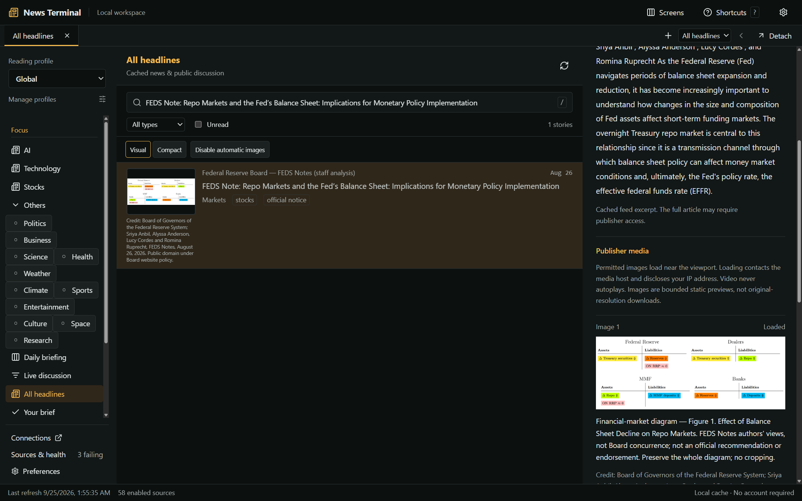
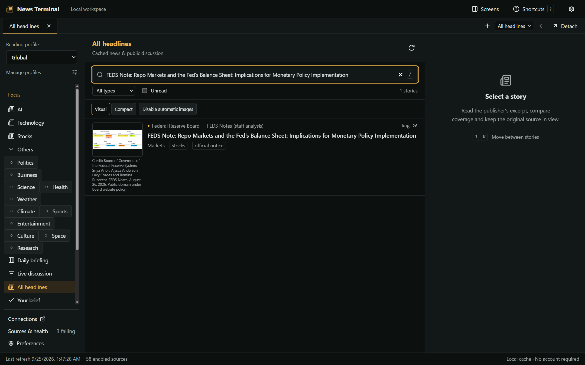

# News Terminal

A Windows news workspace for RSS/Atom headlines, publisher excerpts and public discussion. Follow AI, technology and markets, search your local cache, and keep a reading desk across multiple monitors.

[](https://github.com/Skytuhua/News-Terminal/actions/workflows/ci.yml)
[](LICENSE)

**Windows x64 · Local SQLite storage · No News Terminal account required**

[Start on Windows](#start-on-windows) · [Reading tools](#reading-tools) · [Documentation](docs/index.md) · [Contribute](CONTRIBUTING.md)


*Native Windows capture, September 2026; the controls predate the latest reading tools. NASA's lunar illustration is an artistic concept. Publisher credits are preserved.*

## What you can do

| Workflow | Tools |
| --- | --- |
| Follow your interests | AI, Technology and Stocks sections, other topics, custom feeds, separate reading profiles and watchlists. |
| Find the right story | Search cached headlines and excerpts; combine content type, read status, publisher and publication-age filters. |
| Clear a backlog | Select the current page, mark stories read or unread, save or unsave, and hide in bulk. Recover retained items in Hidden stories. |
| Keep your place | Background arrivals wait behind **Show latest**. Adjust pane widths, reorder tabs and detach them into native windows; workspace layout returns on restart. |
| Catch up | A source-linked daily headline briefing, with optional per-story AI summaries and sector source quotations for permitted inputs. |
| Explore AI metadata | Separate News, Models and Benchmarks views, with model-catalog changes and independent benchmark provenance. |

Profiles, workspace and permitted cached excerpts live on your PC. Reading cached content does not require a refresh; saving a story keeps its permitted excerpt or metadata and original link, rather than a guaranteed offline full article.

<details>
<summary>More native screenshots</summary>



*September 2026, older UI. The reader retains source attribution and the authors' views/no-endorsement notice.*



*September 2026, older UI. The image is a financial-market diagram, not an equities photograph or investment recommendation.*

</details>

## Start on Windows

### Download a development build

**[Browse successful Windows builds on main](https://github.com/Skytuhua/News-Terminal/actions/workflows/ci.yml?query=branch%3Amain+is%3Asuccess)**

1. Open a successful run for the revision you want to try.
2. Under **Artifacts**, download `news-terminal-windows-unsigned` and unzip it. GitHub sign-in is required; artifacts expire according to GitHub's retention settings.
3. Run the `*-setup.exe` installer, or use `news-terminal.exe` if WebView2 is already installed.

These are **unsigned Windows x64 development builds**. Windows may show a SmartScreen warning. No tagged release is published yet; a successful run verifies that revision, not later changes.

Current setup builds bundle Microsoft's offline WebView2 installer to install the runtime when it is missing. The standalone executable and separately packaged portable ZIP require an existing [Microsoft WebView2 Runtime](https://developer.microsoft.com/en-us/microsoft-edge/webview2/#download-section). Runtime installation can still be affected by Windows policy; see the [installer documentation](docs/installer-payload.md).

### Build from source

Use **Windows**, **Node.js 24/npm**, **stable Rust with the MSVC toolchain**, **Visual Studio C++ build tools/Windows SDK**, and **WebView2**. See [Tauri's Windows prerequisites](https://v2.tauri.app/start/prerequisites/#windows).

```sh
git clone https://github.com/Skytuhua/News-Terminal.git
cd News-Terminal
npm ci
npm run tauri -- dev
```

To build an installer:

```sh
npm run tauri -- build --bundles nsis
```

The installer is under `src-tauri/target/release/bundle/nsis/`; the standalone app is `src-tauri/target/release/news-terminal.exe`. Building the bundled WebView2 prerequisite needs access to Microsoft's Evergreen download. Follow [installer payload verification](docs/installer-payload.md#current-release-owner-sequence) before distributing a build.

### First reading session

1. Open **Preferences** and choose your topics, languages and regions.
2. Review **Sources & health** or add a permitted HTTPS RSS/Atom feed. Startup refresh runs automatically.
3. Open a story, save it for later, or choose **Daily briefing**. Detach a tab to give another screen its own reader.

## Reading tools

Use **More filters** to choose a publisher and **Any time**, **Past 24 hours**, **Past 7 days** or **Past 30 days**. These work together with search, content type and read status. Time ranges use the publisher's publication date; undated stories are excluded from bounded ranges. **Clear filters** helps recover an empty filtered view.

**Select this page** selects up to 100 visible stories without marking them read. Then choose a bulk read/unread, save/unsave or hide action. **Invert selection** switches the selection to the other stories on the current page; **Clear selection** cancels it. Page and filter changes clear selection so actions stay scoped to the list you are viewing. Individual Hide actions offer Undo; **Hidden stories** provides recovery while a story remains cached.

### Keyboard shortcuts

| Key | Action |
| --- | --- |
| `/` or `Ctrl+K` | Focus cached-story search |
| `J` / `K` | Open the next / previous story |
| `S` | Save / unsave the open story |
| `M` | Mark the open story read / unread |
| `X` | Hide the open story |
| `O` | Open the original in your browser |
| `R` | Refresh feeds |
| `Ctrl+T` / `Ctrl+W` | New / close tab in the main window |
| `Ctrl+Tab` / `Ctrl+Shift+Tab` | Next / previous tab in the main window |
| `?` / `Escape` | Show shortcuts / close the current dialog or reading pane |

Single-key shortcuts pause while you type in a field. Open **Shortcuts** in the app for the full reference.

## Optional local AI

Summaries support **Ollama** and an **OpenAI-compatible local server**, such as LM Studio or llama.cpp. Install and start the runtime and model separately; they are not bundled with News Terminal.

In **Preferences → AI providers**, enter the exact model identifier, enable the provider, give consent and save. The compatible server also needs an HTTP loopback base URL, for example `http://127.0.0.1:1234/v1`. Saving settings does not contact the server or generate a summary. Configure the runtime itself to keep inference local: a loopback address alone does not establish where it runs the model.

AI starts disabled, requires source-level permission, and is unavailable for most bundled feeds. Cloud summary execution is blocked in this build. Generated summaries and AI-selected quotations remain unverified; check the linked originals. [Local AI setup and limitations →](docs/local-ai.md)

The Models and Benchmarks views retrieve metadata without provider keys or inference requests. OpenRouter, selected model repositories, Arena and SWE-bench retain their own coverage, metrics and provenance.

## Sources and privacy

The starter catalog has **69 feed entries, 58 enabled by default**. Coverage depends on those feeds, your preferences and upstream availability. Hacker News discussion views retrieve story metadata; Bluesky, Reddit and X open external links or searches.

Publisher terms still apply, including personal/noncommercial restrictions for some feeds. Images are opt-in and follow source/item permissions, with credits retained; most starter-feed stories have no approved image. Feed refreshes and image loads contact their hosts. The system WebView2 runtime also has its own background network behavior.

Alerts are opt-in and operate while the app is running. JSON backups contain reading preferences and history, exclude credentials, and should be stored privately.

[Source catalog](docs/sources.md) · [Source policy](docs/source-policy.md) · [Privacy and backups](docs/privacy.md) · [Third-party notices](THIRD_PARTY_NOTICES.md)

## Contribute

[Report a bug, request a feature or suggest a feed](https://github.com/Skytuhua/News-Terminal/issues/new/choose). For code changes, start with [CONTRIBUTING.md](CONTRIBUTING.md) and the [developer guide](docs/development.md).

Built with **Tauri 2 · Rust · React · TypeScript · SQLite/FTS5**. Rust owns networking, storage and native windows; React renders typed snapshots and sends explicit actions. The [IPC contract](docs/IPC-CONTRACT.md) describes that boundary.

## License

Code is [MIT licensed](LICENSE). Publisher content, dependencies and AI models retain their own terms and attribution requirements.
