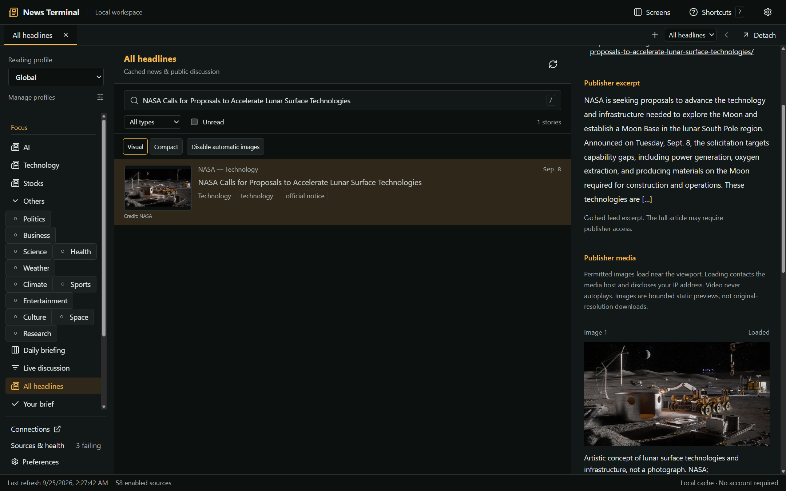

<div align="center">

# News Terminal

**Follow AI, technology and markets from your own Windows news desk.**

A desktop workspace for RSS/Atom headlines, publisher excerpts and public discussion.<br>
Search your cache, save stories and move tabs between monitors.

[](https://github.com/Skytuhua/News-Terminal/actions/workflows/ci.yml)
[](LICENSE)


**[Start on Windows](#start-on-windows) · [Explore the sources](docs/sources.md) · [Privacy](docs/privacy.md) · [Contribute](#contribute)**

</div>



*Native Windows capture, September 2026. NASA's lunar-technology illustration is an artistic concept; source attribution is preserved. The capture predates the latest UI updates.*

## A desk that fits how you read

| What you want | What News Terminal gives you |
| --- | --- |
| **Follow your interests** | Focused AI, Technology and Stocks sections, plus other topics, custom feeds and separate reading profiles. |
| **Find a story again** | Search the local headline/excerpt cache and keep saved stories with their original links. Cached content remains readable without refreshing. |
| **Clear your backlog** | Read/unread filters, bulk save/read/hide actions and keyboard navigation. Individual Hide actions offer Undo; background arrivals wait behind **Show latest** while you read. |
| **Give stories room** | A headline list and reader pane, adjustable widths, and tabs that detach into native windows across monitors. Your window layout returns on restart. |
| **Catch up from your cache** | A daily, source-linked headline briefing, with optional per-story AI summaries and sector source quotations for permitted inputs. |

The core reader requires no News Terminal account, subscription or hosted backend. Your profiles, workspace and cached excerpts live on your PC.

## Start on Windows

### Try a development build

[Open the successful Windows CI build](https://github.com/Skytuhua/News-Terminal/actions/runs/38459176857#artifacts) or [browse newer builds](https://github.com/Skytuhua/News-Terminal/actions/workflows/ci.yml).

Under **Artifacts**, download `news-terminal-windows-unsigned`, unzip it, and run the installer or application. GitHub sign-in is required; artifacts are available while GitHub retains them. These are **unsigned development builds**, so Windows may show a SmartScreen warning. No tagged release is published yet.

The linked development build requires an existing [Microsoft WebView2 Runtime](https://developer.microsoft.com/en-us/microsoft-edge/webview2/#download-section). Installers newly built from this source bundle the offline WebView2 installer and install the runtime when it is missing. The standalone application and portable ZIP still require WebView2 to be installed separately.

### Build from source

You need **Windows**, **Node.js 24/npm**, **stable Rust with the MSVC toolchain**, **Visual Studio C++ build tools/Windows SDK**, and **WebView2**. See [Tauri's Windows prerequisites](https://v2.tauri.app/start/prerequisites/#windows).

```sh
git clone https://github.com/Skytuhua/News-Terminal.git
cd News-Terminal
npm ci
npm run tauri -- dev
```

To create your own installer:

```sh
npm run tauri -- build --bundles nsis
```

Find it under `src-tauri/target/release/bundle/nsis/`. The standalone application is `src-tauri/target/release/news-terminal.exe`. The build machine needs access to Microsoft's Evergreen runtime download for the bundled prerequisite. See [installer payload verification](docs/installer-payload.md#current-release-owner-sequence) before distributing a new build.

### Make it yours

1. Open **Preferences** and choose your topics, languages and regions.
2. Use **Sources & health** to review the catalog or add a permitted HTTPS RSS/Atom feed. Startup refresh runs automatically.
3. Save stories, open the daily briefing, or detach a tab to another screen. Open **Shortcuts** for keyboard controls.

## Optional AI discovery and summaries

The AI section separates **News**, **Models** and **Benchmarks**. Browse OpenRouter catalog changes and selected model-repository metadata without provider keys or inference requests. Arena and SWE-bench keep their own metrics and provenance.

For summaries, the current build uses **local Ollama**, installed separately with a model. AI starts disabled and requires your consent plus source-level permission; most bundled feeds are not approved for AI processing. Cloud summary execution is blocked in this build. Generated text and selected quotations are unverified—check the linked originals.

## Sources, media and privacy

The starter catalog has **69 feed entries, 58 enabled by default**. Coverage depends on those feeds and your language choices. Hacker News discussion views retrieve story metadata; Bluesky, Reddit and X open external links/searches.

Saved content contains permitted feed excerpts or metadata and the original URL. Publisher terms still apply, including personal/noncommercial restrictions for some feeds. Images are opt-in and follow source/item permissions, with credits retained; most starter-feed stories have no approved image.

Feed refreshes and image loads contact their hosts. The system WebView2 runtime also has its own background-network behavior. Alerts are opt-in and operate while the app is running; backups contain reading preferences/history and exclude credentials.

[Source catalog](docs/sources.md) · [Source policy](docs/source-policy.md) · [Privacy and backups](docs/privacy.md) · [Third-party notices](THIRD_PARTY_NOTICES.md)

## Contribute

[Report a bug](https://github.com/Skytuhua/News-Terminal/issues) with reproduction steps, your Windows version and the relevant error. Suggest a feed with its official RSS/Atom URL and terms of use, or send a focused pull request.

Start with the [developer guide](docs/development.md) for checks, native smoke tests and architecture. The app uses **Tauri 2 · Rust · React · TypeScript · SQLite/FTS5**. The [IPC contract](docs/IPC-CONTRACT.md) documents the frontend/host boundary.

If News Terminal helps your reading routine, a GitHub star helps other readers find it.

## License

Code is [MIT licensed](LICENSE). Publisher content, dependencies and AI models retain their own terms and attribution requirements.
